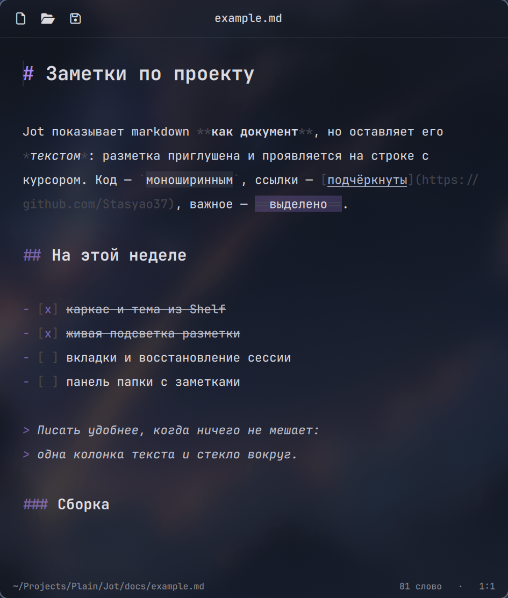

<div align="center">


# Jot

**Markdown-редактор для Hyprland в стиле глассморфизма — на Qt 6 / QML**

Часть офисного пакета Plain от студии [Nook](https://github.com/nook-apps)




</div>

---

> [!NOTE]
> Jot в самом начале пути: панели папки, оглавления и поиска пока нет —
> см. [план](#-план). Пакетов ещё нет, только [сборка из исходников](#-сборка-из-исходников).

## ✨ Зачем

Jot — первое приложение офисного пакета **Plain** (Jot, Page, Grid, Deck) от студии **Nook** и
сосед файлового менеджера [Shelf](https://github.com/Stasyao37/shelf): тот же визуальный язык
Glaze — стекло, цвета из обоев, одна деталь с наклоном, — свой `app_id` и `.desktop`. Редактор для заметок и документов в Markdown, который
выглядит частью рабочего стола на Hyprland, а не гостем из GNOME или KDE.

**Живой исходник.** Файл остаётся обычным markdown — никакого скрытого формата и отдельного
окна предпросмотра. Но читается он как документ: заголовки крупнее и жирнее, **жирное** жирным,
код моноширинным на подложке, ссылки подчёркнуты, выполненные задачи зачёркнуты. Знаки разметки
приглушены и проявляются на строке, где стоит курсор: видно, что правишь, и не мешает читать.

**Глассморфизм.** Полупрозрачное окно, которое Hyprland размывает обычным `blur`, — как у
Shelf. Цвета берутся у [matugen](https://github.com/InioX/matugen) или у бара на Quickshell и
меняются вместе с обоями. Фирменный фиолетовый Jot — только штрихами: курсор, знаки `#`,
маркеры списков.

**Не терять написанное.** Файл с именем сохраняется сам через полторы секунды после паузы в
наборе, запись атомарная — оборванное сохранение не оставит полфайла.

**Нативный, а не браузер в окне.** Популярные редакторы заметок собраны на Electron: внутри
каждого — свой Chromium с десятком процессов. Jot — один процесс на Qt Quick, рисует через
GPU и пользуется теми же библиотеками Qt, что Shelf и другие Qt-программы в системе. Поэтому
он открывается за полсекунды, а окно ведёт себя как родное для Wayland: свой `app_id` для
правил Hyprland, размытие композитора под стеклом и цвета обоев без тем и плагинов.

## ⚡ Сколько весит

Один и тот же ноутбук (Fedora 43, Qt 6.10, Hyprland), повторный запуск, три замера.
Память — PSS всего дерева процессов через 10 секунд после старта:

| | Jot 0.1 | Obsidian 1.14 (Flatpak) |
|---|---|---|
| Окно на экране | ~0,5 с | 1,5–2 с (первый запуск — 4,5 с) |
| Процессов | 1 | 12 |
| Память | ~105 МБ | ~450 МБ |
| На диске | 0,4 МБ + Qt из системы | 672 МБ + среда Flatpak |

Сравнение не на равных: Obsidian открывает целое хранилище с плагинами и индексом, а Jot пока
умеет меньше — с вкладками и панелью папки его цифры подрастут. Но разница в разы идёт от
движка, а не от возможностей: браузер со всеми его процессами поднимается ещё до первой заметки.

## 🧩 Возможности

- **Подсветка** — заголовки шести уровней, жирный, курсив, зачёркнутый, `==выделение==`, код в
  строке и блоки ```` ``` ```` / `~~~` с языком, ссылки и картинки, адреса, цитаты, списки
  и задачи `- [ ]`, таблицы, горизонтальные линии, HTML-комментарии
- **Списки** — <kbd>Enter</kbd> продолжает пункт (номер растёт, у задачи — пустой флажок),
  <kbd>Enter</kbd> на пустом пункте выходит из списка; так же в цитатах
- **Оформление выделения** — жирный, курсив, код, зачёркнутый; повторное нажатие снимает
- **Автосохранение** и атомарная запись; переводы строк Windows (CRLF) сохраняются как были
- **Изменения снаружи** — файл поправили в другой программе или `git checkout`: Jot перечитает
  его сам, а если здесь есть несохранённые правки — спросит, чью версию оставить
- **Окна «Открыть» и «Сохранить»** — через xdg-desktop-portal: с бэкендом Shelf откроется окно
  Shelf, иначе — окно вашего окружения
- **Вкладки** — перетаскиваются мышью, средняя кнопка закрывает; у несохранённой —
  фиолетовая точка. Безымянная вкладка называется по первой строке текста
- **Одно окно** — `jot файл.md`, двойной щелчок в Shelf или файл, брошенный в окно, открываются
  вкладкой в уже открытом Jot, а не новым окном
- **Сессия** — вкладки и места курсора возвращаются при следующем запуске, в том числе после
  выключения или сбоя. Закрыть окно можно без вопросов: файлы дописываются на диск, а текст
  безымянных вкладок сохраняется черновиком и вернётся вместе с ними
- **Строка состояния** — путь к файлу, число слов, строка и столбец

## ⌨️ Горячие клавиши

| Клавиши | Действие |
|---|---|
| <kbd>Ctrl</kbd>+<kbd>N</kbd>, <kbd>Ctrl</kbd>+<kbd>T</kbd> | Новая вкладка |
| <kbd>Ctrl</kbd>+<kbd>O</kbd> | Открыть |
| <kbd>Ctrl</kbd>+<kbd>S</kbd> | Сохранить |
| <kbd>Ctrl</kbd>+<kbd>Shift</kbd>+<kbd>S</kbd> | Сохранить как |
| <kbd>Ctrl</kbd>+<kbd>B</kbd> | Жирный |
| <kbd>Ctrl</kbd>+<kbd>I</kbd> | Курсив |
| <kbd>Ctrl</kbd>+<kbd>E</kbd> | Код в строке |
| <kbd>Ctrl</kbd>+<kbd>Shift</kbd>+<kbd>X</kbd> | Зачёркнутый |
| <kbd>Ctrl</kbd>+<kbd>Z</kbd> / <kbd>Ctrl</kbd>+<kbd>Shift</kbd>+<kbd>Z</kbd> | Отменить / вернуть |
| <kbd>Ctrl</kbd>+<kbd>W</kbd> | Закрыть вкладку |
| <kbd>Ctrl</kbd>+<kbd>Tab</kbd>, <kbd>Ctrl</kbd>+<kbd>PgDn</kbd> / <kbd>PgUp</kbd> | Следующая / предыдущая вкладка |
| <kbd>Alt</kbd>+<kbd>1</kbd>…<kbd>9</kbd> | Вкладка по номеру (<kbd>9</kbd> — последняя) |
| <kbd>Ctrl</kbd>+<kbd>Q</kbd> | Закрыть окно |

## 🔧 Сборка из исходников

Нужны Qt ≥ 6.7 (Base, Declarative), CMake ≥ 3.21, Ninja и компилятор с C++20.

```sh
# Fedora
sudo dnf install qt6-qtbase-devel qt6-qtdeclarative-devel cmake ninja-build gcc-c++
# Arch
sudo pacman -S qt6-base qt6-declarative cmake ninja

cmake -B build -G Ninja -DCMAKE_INSTALL_PREFIX=~/.local
cmake --build build
cmake --install build
```

Запуск: `jot` — вкладки прошлого раза, `jot заметка.md` — они же и файл новой вкладкой (если файла
нет, он будет создан при первом сохранении). Сессия лежит в `~/.local/state/jot/session.json`.

Для текста нужен шрифт [JetBrains Mono](https://www.jetbrains.com/lp/mono/)
(`jetbrains-mono-fonts` в Fedora, `ttf-jetbrains-mono` в Arch). Значки интерфейса вшиты в программу.

Сделать Jot редактором Markdown по умолчанию:

```sh
xdg-mime default io.github.nook_apps.Jot.desktop text/markdown
```

> [!NOTE]
> Сборка ограничена четырьмя параллельными компиляторами (`JOB_POOLS` в `CMakeLists.txt`):
> каждый `cc1plus` с Qt занимает около 350 МБ — как и в Shelf.

## 🎨 Тема

Цвета и стекло Jot берёт там же, где Shelf. «Автоматически» — первое найденное:

| Источник | Файл |
|---|---|
| Quickshell | `~/.local/state/quickshell/user/generated/qs_theme.json` |
| matugen — шаблон Jot, а если его нет — шаблон Shelf | `~/.local/state/jot/colors.json`, `~/.local/state/shelf/colors.json` |
| Material из шелла (формат end-4) | `~/.local/state/quickshell/user/generated/colors.json` |
| встроенная светлая или тёмная | по `color-scheme` из xdg-desktop-portal |

Шаблон у Jot и Shelf один, так что если Shelf уже подключён к matugen, Jot получит цвета обоев
без настройки. Файлы отслеживаются: смена обоев перекрашивает открытое окно сразу.

**Стекло** — как в `~/.config/quickshell/settings.json`, если он есть, иначе включено, когда в
Hyprland включено размытие.

**qt6ct.** Если в системе стоит `QT_QPA_PLATFORMTHEME=qt6ct`, он подмешивает в шрифт приложения
начертание «Regular», и жирный текст в Qt рисуется обычным. Jot это начертание сбрасывает при
запуске — жирное остаётся жирным.

## 🗺️ План

К версии 0.1:

- [x] окно, тема и стекло из Shelf
- [x] живая подсветка markdown, курсорная строка
- [x] открыть / сохранить через портал, автосохранение, изменения на диске
- [x] вкладки, одно окно на сеанс, сессия с черновиками
- [ ] панель папки: дерево `.md`-файлов рядом с текстом
- [ ] оглавление по заголовкам, поиск и замена
- [ ] настройки (<kbd>Ctrl</kbd>+<kbd>,</kbd>): источник цветов, стекло, автосохранение

Дальше — пакеты для Fedora, Debian/Ubuntu, Arch и Nix, как у Shelf, и общий модуль интерфейса
Plain, когда появится второе офисное приложение.

## 🗂️ Структура

```
src/            C++: документ (загрузка, сохранение, слежение за файлом), подсветка
                markdown, окна выбора файлов через портал, сессия, одно окно (D-Bus),
                источник темы
qml/            интерфейс: окно, вкладки, редактор, кнопки и диалоги, тема
fonts/          вшитые символы значков интерфейса (из JetBrainsMono Nerd Font)
tools/          subset_icons.py — сборка шрифта значков
data/           шаблон .desktop-файла, иконка приложения
docs/           картинки и пример для README
```

Тема (`qml/Theme.qml`, `src/ThemeSource.*`), кнопки и диалоги пока скопированы из Shelf; общим
модулем они станут вместе со вторым приложением Plain.

## 📜 Благодарности

- Иконка — из дизайн-системы «Shelf · Pick · Plain»
- Значки интерфейса — из [JetBrainsMono Nerd Font](https://www.nerdfonts.com) (OFL / MIT),
  вшиты в программу (`fonts/`)

## 📄 Лицензия

Jot распространяется под [GNU GPL v3](LICENSE) или более поздней версией (GPL-3.0-or-later).

- Шрифт значков `fonts/` — SIL Open Font License 1.1 (`fonts/OFL.txt`), значки Nerd Fonts — MIT / OFL
